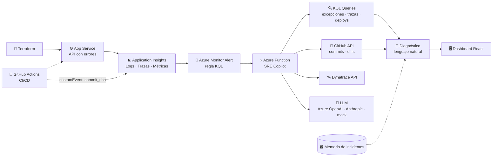

# 🤖 SRE Copilot

> **Diagnóstico de incidentes asistido por IA.** Cuando tu app explota con un HTTP 500 a las 3 a.m., SRE Copilot correlaciona logs, trazas, métricas y commits de GitHub para decirte *qué se rompió, cuándo y quién lo desplegó* — en segundos, no en horas.

<p align="center">
  
  
  
  
  
  
  
</p>

---

## 🧠 ¿Por qué existe?

Cuando una aplicación falla, los equipos de SRE pierden **horas** haciendo detective manual entre:

- 🕵️ Logs y excepciones dispersos en Application Insights
- 📉 Métricas de latencia y disponibilidad
- 🔀 Trazas distribuidas entre dependencias
- 🗂️ Historial de deploys y commits recientes

**SRE Copilot automatiza esa investigación.** Un motor agéntico planifica, consulta las fuentes de
evidencia reales, correlaciona el resultado con el historial de GitHub y entrega un diagnóstico en lenguaje
natural **con la evidencia que lo sostiene a la vista**.

> *"El error 500 empezó tras el deploy del commit `a3f21bc`, causado por una cadena de conexión mal
> configurada en el App Service."*

---

## ⚡ Cómo funciona



### 🧰 El motor es agéntico, no un prompt

El diagnóstico no es una llamada única al LLM. Es un **ciclo con herramientas**: el modelo planifica,
invoca las herramientas que necesita, observa los resultados, refina y produce un veredicto. La
superficie de herramientas es:

| Herramienta | Qué consulta |
|---|---|
| `query_exceptions` | KQL sobre `exceptions`: agrupación por tipo y mensaje, con ventana temporal |
| `query_traces` | KQL sobre `requests`/`dependencies`: latencia p50/p95 y dependencias con error |
| `query_custom_events` | KQL sobre `customEvents`: busca `name == "Deploy"` y devuelve `commit_sha` |
| `query_metrics` | KQL sobre `customMetrics`: disponibilidad y tasa de error por minuto |
| `list_recent_commits` | Commits recientes del repositorio vía GitHub API |
| `get_commit_diff` | Diff de un commit concreto |
| `blame_deploy_window` | Commits dentro de la ventana del incidente |
| `search_logs` | Búsqueda de texto libre en la ventana |
| `dynatrace_problems` | Problemas abiertos en Dynatrace para el servicio |

> **Regla de oro: el modelo no inventa.** Cada commit, cada marca de tiempo y cada hash del veredicto
> tiene que proceder de una herramienta. El ensamblador descarta lo que no puede trazar y lo anota en
> `uncertainties`. Está cubierto por `copilot-function/test/mock-traceability.test.ts`.

### 🔍 Consultas KQL clave

```kusto
// ¿Qué se está rompiendo y dónde?
exceptions
| where timestamp > ago(15m)
| summarize count() by type, outerMessage, operation_Name
| order by count_ desc

// ¿Coincide con algún deploy reciente?
customEvents
| where name == "Deploy"
| top 1 by timestamp desc
| project commit_sha = tostring(customDimensions.commitSha), deployedAt = timestamp
```

---

## 🗺️ Flujo del diagnóstico (paso a paso)

| Paso | Componente | Qué hace |
|---|---|---|
| 1️⃣ | **Terraform** | Despliega Resource Group, App Service, Application Insights, Azure Function, Key Vault, Azure OpenAI, AI Search y Static Web App |
| 2️⃣ | **GitHub Actions** | Publica la app y envía un `customEvent` a App Insights con `commit_sha`, versión y timestamp |
| 3️⃣ | **Azure Monitor Alert** | Regla KQL: *">5 excepciones en 5 minutos"* → dispara webhook hacia la Function |
| 4️⃣ | **Azure Function (Copilot)** | Corre el ciclo agéntico: plan → herramientas → evidencia → veredicto, y lo transmite por SSE |
| 5️⃣ | **Frontend React** | Muestra el plan, las llamadas a herramientas en vivo, la evidencia acumulada, causa raíz, commits sospechosos, timeline y recomendaciones |

---

## 🛠️ Stack tecnológico

| Capa | Tecnología |
|---|---|
| ☁️ Cloud | Azure (App Service, Functions, Monitor, Key Vault, AI Search, OpenAI) |
| 📦 Infraestructura | Terraform (IaC) |
| 🔁 CI/CD | GitHub Actions |
| 🔎 Observabilidad | Application Insights · KQL · Dynatrace API |
| ⚙️ Backend | Node.js 22 · TypeScript · Express · OpenTelemetry |
| 🧠 Motor de diagnóstico | Azure Functions v4 (Node 20) · TypeScript · tool calling |
| 🖥️ Frontend | React 18 · Vite · TypeScript |
| 🧰 Interoperabilidad | Model Context Protocol (servidor stdio) |
| 🗝️ Secretos | Azure Key Vault |

---

## 📁 Estructura del proyecto

```
SRE-Copilot/
├── infrastructure/      # Terraform: RG, App Service, Insights, Function, OpenAI, AI Search, Key Vault
├── backend/             # API de demostración con errores instrumentados a propósito
├── copilot-function/    # Azure Function: motor de diagnóstico agéntico + servidor MCP
├── frontend/            # Dashboard React del diagnóstico
├── guia/                # Guía de comandos para la competencia (Azure · Dynatrace · Terraform · KQL)
├── .github/workflows/   # CI/CD con customEvent de deploy
└── CONTRACTS.md         # Contratos entre componentes (esquemas, API, herramientas)
```

---

## 🚀 Quickstart

```bash
# 1. Clona el repositorio
git clone https://github.com/FerminGonzalez/SRE-Copilot.git
cd SRE-Copilot

# 2. Despliega la infraestructura
cd infrastructure
terraform init
terraform apply

# 3. Lanza el backend local (API con errores)
cd ../backend
npm install && npm run dev

# 4. Lanza el copilot local
cd ../copilot-function
npm install && npm run dev

# 5. Lanza el frontend
cd ../frontend
npm install && npm run dev
```

### 🧪 Ejecutar sin cloud

Todo el proyecto funciona **sin credenciales de Azure**. El motor usa un proveedor LLM `mock`
determinista por defecto, las herramientas tienen *fallbacks* offline y la memoria de incidentes usa
un índice local con embeddings deterministas.

```bash
cd copilot-function
LLM_PROVIDER=mock npm run dev
```

---

## 🤖 El motor de diagnóstico

### Tres proveedores de LLM, una interfaz

| `LLM_PROVIDER` | Qué usa | Cuándo |
|---|---|---|
| `azure-openai` | `@azure/openai` v1 con tool calling nativo | Producción en Azure |
| `anthropic` | API Messages con `tool_use` / `tool_result` | Alternativa multi-nube |
| `mock` | Determinista, sin red | Tests, CI y demostraciones offline |

El proveedor `mock` **no improvisa**: responde con lo que vio en las herramientas. Con cero evidencia
devuelve `confidence: "low"` y listas vacías.

### 💾 Memoria de incidentes

Cada diagnóstico se guarda y se puede recuperar por similitud, para que el copilot sepa que un
incidente parecido ya se investigó. Usa **Azure AI Search** cuando `AZURE_SEARCH_ENDPOINT` está
definido y, si no, un índice local con embeddings deterministas y similitud coseno.

### 🔌 Servidor MCP

Las mismas nueve herramientas se publican como un **servidor MCP sobre stdio**, para que cualquier
agente externo pueda usarlas:

```bash
cd copilot-function && npm run mcp
```

---

## 🎯 Estado del proyecto

- [x] Definición de arquitectura y flujo de alertas
- [x] Infraestructura como código (Terraform) — App Service, Insights, Function, OpenAI, AI Search, Key Vault
- [x] Backend con errores instrumentados y operación por nombre
- [x] Consultas KQL de diagnóstico (9 herramientas con schema JSON)
- [x] Correlación con GitHub API (commits, diffs, ventana de deploy)
- [x] Diagnóstico en lenguaje natural con ciclo agéntico y streaming SSE
- [x] Dashboard React con timeline, evidencia y control de feedback
- [x] Memoria de incidentes con fallback local (RAG)
- [x] Servidor MCP con las herramientas de diagnóstico
- [x] CI/CD con emisión del `customEvent` de deploy
- [x] 133 tests (43 backend · 43 copilot-function · 47 frontend)

---

## 🧪 Verificación

```bash
cd backend        && npm run build && npm run typecheck && npm run lint && npm test
cd ../copilot-function && npm run build && npm run typecheck && npm run lint && npm test
cd ../frontend    && npm run build && npm run typecheck && npm run lint && npm test

cd ../infrastructure && terraform fmt -check -recursive . && terraform validate
```

Todos los tests corren **sin red y sin credenciales**.

---

## 🔐 Seguridad

- Ningún secreto en el código, en los `.env.example` ni en los fixtures. Se verificaba con grep.
- Las credenciales viajan por **Key Vault** y se inyectan en la Function App como app settings.
- `DATABASE_URL` se **redacta** antes de escribirse en el log (puede contener `usuario:contraseña`).
- La Function App de producción usa identidad administrada; el `GITHUB_TOKEN` y las claves de AI Search
  se resuelven en el momento del `apply` desde el propio vault.

---

<p align="center">
  🏗️ Proyecto para <b>Hackathon Cloud & Observability</b> · Azure + Terraform + KQL + Dynatrace
</p>
